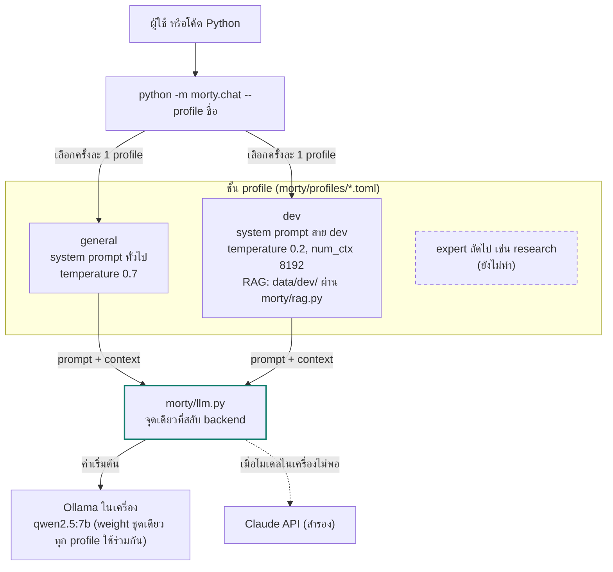

# morty-model

โครงโปรเจกต์ LLM ที่รันบนเครื่องตัวเองด้วย [Ollama](https://ollama.com) ฟรีทั้งหมด ข้อมูลไม่ออกนอกเครื่อง
เขียนด้วย Python ออกแบบให้ย้ายไปใช้ Claude API ได้ภายหลังโดยแก้ไฟล์เดียว

แนวคิดหลัก: **โมเดลกลางหนึ่งตัว แตกเป็น expert หลายด้านผ่าน profile** โดยไม่ต้องเทรนโมเดลใหม่
ตอนนี้มี profile `general` (ผู้ช่วยทั่วไป) และ `dev` (expert สายพัฒนาซอฟต์แวร์ พร้อม RAG จากเอกสารใน `data/dev/`)

## โครงสร้างระบบ



วงจรทำให้ดีขึ้น: ใช้งานจริง → log → eval set (`evals/<profile>.jsonl`) → วัดผล → ปรับ prompt / RAG / โมเดล แล้ววนซ้ำ
ทุกการเปลี่ยนแปลงต้องรัน eval เดิมซ้ำเพื่อดูจากตัวเลขว่าดีขึ้นหรือแย่ลง
LoRA fine-tune เป็นทางแยกที่เปิดเมื่อ log สะสมได้หลายร้อยชุดขึ้นไปเท่านั้น

## ความต้องการของเครื่อง

- macOS บน Apple Silicon (ทดสอบบน MacBook Pro M4 RAM 24 GB)
- Python 3.12 ขึ้นไป
- พื้นที่ว่างประมาณ 15 GB สำหรับโมเดล

## ติดตั้งครั้งแรก

```bash
# 1) ติดตั้ง Ollama (ถ้ามี Homebrew ใช้ brew install ollama ได้เลย)
mkdir -p ~/.local/ollama ~/.local/bin
curl -fsSL -o /tmp/ollama.tgz https://github.com/ollama/ollama/releases/latest/download/ollama-darwin.tgz
tar -xzf /tmp/ollama.tgz -C ~/.local/ollama
ln -sf ~/.local/ollama/ollama ~/.local/bin/ollama
echo 'export PATH="$HOME/.local/bin:$PATH"' >> ~/.zshrc && source ~/.zshrc

# 2) เปิด server แล้วดึงโมเดล
ollama serve &
ollama pull qwen2.5:7b          # โมเดลแชท ขนาดเล็ก ตอบเร็ว
ollama pull qwen3:14b           # โมเดลแชท ฉลาดกว่า ใช้ RAM ราว 10 GB
ollama pull nomic-embed-text    # โมเดล embedding สำหรับทำ RAG

# 3) ติดตั้ง Python dependencies
python3.12 -m venv .venv
.venv/bin/pip install -r requirements.txt
cp .env.example .env
```

## ใช้งาน

```bash
# แชทในเทอร์มินัล (จำบทสนทนาได้ พิมพ์ /quit เพื่อออก)
.venv/bin/python -m morty.chat                  # profile general
.venv/bin/python -m morty.chat --profile dev    # expert สาย dev
.venv/bin/python -m morty.chat --model qwen3:14b

# เรียกจากโค้ด
.venv/bin/python examples_ask.py

# RAG: ใส่เอกสารใน data/dev/ แล้วทำดัชนี (ทำซ้ำทุกครั้งที่เพิ่มหรือแก้ไฟล์)
.venv/bin/python -m morty.rag index dev
.venv/bin/python -m morty.rag search dev "เพิ่ม expert ใหม่ทำยังไง"   # ลองดูว่าค้นเจอท่อนไหน

# รัน eval set ของ profile
.venv/bin/python -m morty.evaluate dev
.venv/bin/python -m morty.evaluate dev --no-rag                      # เทียบผลโดยไม่มี RAG
.venv/bin/python -m morty.evaluate dev --model qwen3:14b --show
```

คำสั่งในหน้าแชท

| คำสั่ง | ความหมาย |
|---|---|
| `/reset` | ล้างบทสนทนา เริ่มใหม่ |
| `/profile <ชื่อ>` | สลับ profile (ล้างบทสนทนาด้วย) พิมพ์ `/profile` เฉยๆ เพื่อดูรายชื่อ |
| `/model <ชื่อ>` | สลับโมเดลกลางคัน |
| `/quit` | ออก |

เรียกจาก Python

```python
from morty import llm

llm.ask("สรุปข้อความนี้ให้หน่อย ...")                        # ถามตอบครั้งเดียว ด้วย profile general
llm.ask("อ่านไฟล์ JSON ใน Python ยังไง", profile="dev")      # ใช้ system prompt และพารามิเตอร์ของ dev
llm.chat([{"role": "user", "content": "สวัสดี"}])          # ส่งบทสนทนาเต็ม
llm.embed(["ข้อความ 1", "ข้อความ 2"])                      # แปลงเป็นเวกเตอร์
```

## Profile

profile คือชั้นที่ซ้อนบนโมเดลกลางตัวเดียวกัน แต่ละตัวเป็นไฟล์ TOML ใน `morty/profiles/` กำหนด

| ฟิลด์ | ความหมาย |
|---|---|
| `title` | ชื่อที่แสดงในหน้าแชท |
| `system` | system prompt ของ expert ด้านนั้น |
| `model` | (ไม่บังคับ) ใช้โมเดลคนละตัวกับค่าใน `.env` เช่น `qwen2.5-coder:7b` |
| `data_dir` | (ไม่บังคับ) โฟลเดอร์เอกสารสำหรับ RAG เช่น `data/dev` |
| `[rag]` | (ไม่บังคับ) `enabled`, `top_k` จำนวนท่อนที่แนบ, `min_score` ความคล้ายขั้นต่ำ |
| `[options]` | พารามิเตอร์ส่งให้ Ollama เช่น `temperature`, `num_ctx` |

เพิ่ม expert ใหม่ = เพิ่มไฟล์ `.toml` หนึ่งไฟล์ + ไฟล์ `evals/<ชื่อ>.jsonl` ไม่ต้องแก้โค้ด
ตั้ง profile เริ่มต้นได้ที่ `MORTY_PROFILE=` ใน `.env`

## RAG

`morty/rag.py` ทำดัชนีไฟล์ข้อความและโค้ดใน `data/<profile>/` ด้วย `nomic-embed-text`
เก็บไว้ที่ `data/<profile>/.morty-index.json` (ไม่ commit) ไฟล์ที่ไม่เปลี่ยนจะไม่ถูกคำนวณซ้ำ
ตอนถาม ระบบจะค้นท่อนที่คล้ายคำถามที่สุด `top_k` ท่อนที่คะแนนถึง `min_score` แล้วแนบไปกับคำถามพร้อมหมายเลขอ้างอิง
หน้าแชทจะแสดงบรรทัด `อ้างอิง: ...` ว่าใช้ท่อนไหนบ้าง ถ้าไม่มีท่อนที่ถึงเกณฑ์จะถามโมเดลตามปกติ

ค่าเริ่มต้นของ dev คือ `top_k = 4`, `min_score = 0.55` (nomic ให้คะแนนพื้นราว 0.45 ถึง 0.50 แม้เนื้อหาไม่เกี่ยวกัน)
ใช้ Python ล้วนคำนวณ cosine similarity พอสำหรับเอกสารหลักร้อยถึงหลักพันท่อน ถ้าใหญ่กว่านั้นค่อยย้ายไป vector DB

`data/dev/morty-project.md` เป็นไฟล์ตัวอย่างเดียวที่ commit ไว้ เพื่อให้ morty-dev ตอบคำถามเกี่ยวกับโปรเจกต์นี้ได้
และเป็นตัวพิสูจน์ว่า RAG ทำงาน: คำถาม `morty-*` ใน eval ตอบไม่ได้ถ้าไม่มี RAG

## Eval

`evals/<profile>.jsonl` หนึ่งบรรทัดต่อหนึ่งข้อ

```json
{"id": "py-json", "q": "คำถาม", "expect_any": ["คำที่ควรมีอย่างน้อยหนึ่งคำ"], "expect_all": ["คำที่ต้องมีทุกคำ"], "thai": true}
```

การตรวจเป็นแบบหยาบ (หาคำในคำตอบ) ไว้จับการถดถอยเวลาแก้ prompt หรือสลับโมเดล ไม่ได้แทนการอ่านคำตอบจริง

ผลล่าสุดบน `qwen2.5:7b` (17 ต.ค. 2026): RAG เปิด 12/12, RAG ปิด 9/12 โดย 2 ข้อที่ตกเป็นคำถามเกี่ยวกับโปรเจกต์ที่โมเดลไม่มีทางรู้เอง
และอีก 1 ข้อโมเดลเผลอตอบเป็นภาษาอังกฤษ ซึ่งเกิดเป็นครั้งคราว ยังไม่ถือว่าแก้แล้ว
ผลแต่ละครั้งถูกเก็บไว้ที่ `evals/results/` (ไม่ commit) เพื่อเทียบย้อนหลังและเป็นวัตถุดิบ fine-tune ในอนาคต

## โครงสร้างโปรเจกต์

```
morty/
  config.py      อ่านค่าจาก .env (โมเดล, host, profile เริ่มต้น)
  llm.py         chat / chat_stream / ask / embed  จุดเดียวที่ต้องแก้ถ้าจะย้ายไป Claude API
  profiles.py    โหลด profile จาก profiles/*.toml
  profiles/
    general.toml Morty ตัวกลาง
    dev.toml     expert สาย dev (เปิด RAG)
  rag.py         ทำดัชนีเอกสารใน data/<profile>/ และค้นท่อนที่เกี่ยวข้อง
  chat.py        แชท CLI แบบจำบทสนทนา สลับ profile ได้ แนบ RAG อัตโนมัติ
  evaluate.py    รัน eval set แล้วสรุปคะแนน
evals/
  dev.jsonl      คำถามทดสอบของ profile dev (12 ข้อ)
  results/       ผลการรันแต่ละครั้ง (ไม่ commit)
examples_ask.py  ตัวอย่างเรียกใช้จากโค้ด
data/
  dev/           เอกสารสำหรับ RAG ของ dev (ไม่ commit ยกเว้น morty-project.md)
    morty-project.md   ตัวอย่างเอกสาร: คู่มือโปรเจกต์นี้เอง
    .morty-index.json  ดัชนี embedding (สร้างด้วย morty.rag index)
.env             ค่าตั้งค่าของเครื่องนี้ (ไม่ commit)
.env.example     แม่แบบค่าตั้งค่า
```

## สลับโมเดล

แก้บรรทัด `MORTY_MODEL=` ใน `.env` หรือใส่ `--model` ตอนรัน หรือใส่ `model =` ในไฟล์ profile
ดูรายชื่อโมเดลที่มีด้วย `ollama list` และดึงเพิ่มด้วย `ollama pull <ชื่อ>`

แนวทางเลือกโมเดลบนเครื่อง RAM 24 GB

| โมเดล | RAM ที่ใช้ | เหมาะกับ |
|---|---|---|
| `qwen2.5:7b` | ~5 GB | พัฒนาและทดสอบประจำวัน ตอบเร็ว |
| `qwen2.5-coder:7b` | ~5 GB | ตัวเลือกสำหรับ profile dev ควรเทียบด้วย eval ก่อน |
| `qwen3:14b` | ~10 GB | งานที่ต้องการความฉลาดมากขึ้น ภาษาไทยดีกว่า |
| `qwen3:32b` | ~20 GB | ฉลาดสุดที่พอรันได้ แต่ช้าและกิน RAM เกือบหมด |

## แผนงาน

| ระยะ | งาน | สถานะ |
|---|---|---|
| 0 | Scaffold: Ollama, `llm.py`, แชท CLI | เสร็จแล้ว |
| 1 | Profile `general` + `dev`, flag `--profile`, eval set สาย dev 10 ข้อ | เสร็จแล้ว |
| 2 | RAG สำหรับ dev: `morty/rag.py` ทำดัชนี `data/dev/` แนบท่อนที่เกี่ยวข้องให้อัตโนมัติ eval มี `--no-rag` ไว้เทียบ | เสร็จแล้ว |
| 3 | เลือกโมเดลกลางจากตัวเลข: เทียบ `qwen2.5:7b`, `qwen2.5-coder:7b`, `qwen3:14b` บน eval เดียวกัน | ถัดไป |
| 4 | LoRA fine-tune ด้วย MLX เมื่อ log สะสมมากพอ ต้องชนะ profile + RAG บน eval เดิมถึงจะใช้ | ภายหลัง |

หลักข้อเดียวที่ยึด: ไม่เปลี่ยนอะไรโดยไม่มี eval รองรับ และไม่ขึ้นชั้นที่แพงกว่าถ้าชั้นที่ถูกกว่ายังไม่ได้ลองจนสุด
