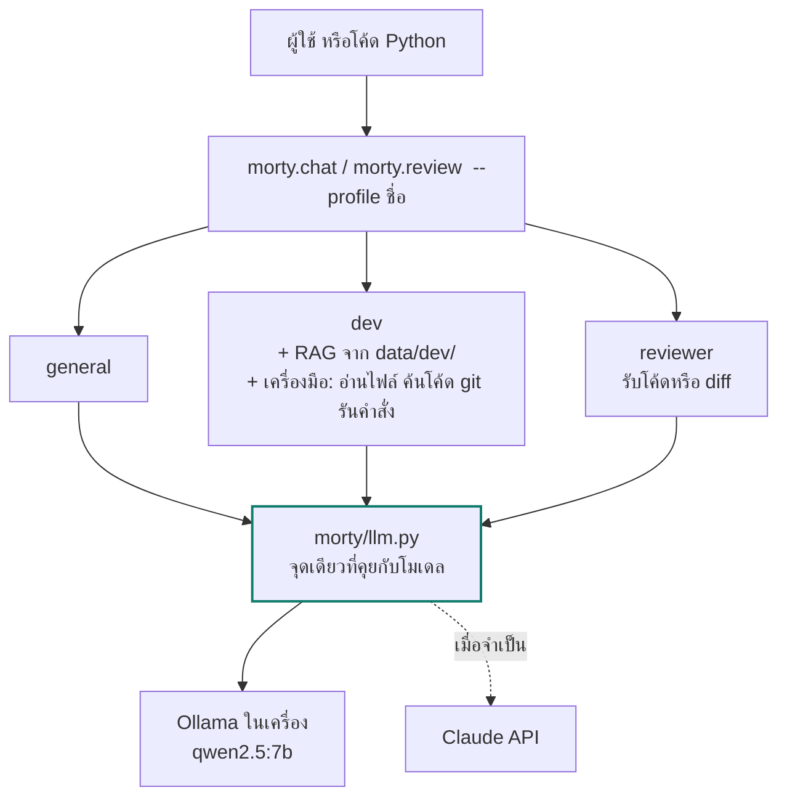

# Morty

ผู้ช่วย AI ที่รันในเครื่องคุณเอง ฟรี ไม่ส่งข้อมูลออกไปไหน
โมเดลกลางหนึ่งตัวบน [Ollama](https://ollama.com) แตกเป็น expert หลายด้านด้วยไฟล์ตั้งค่าไฟล์เดียว ไม่ต้องเทรนใหม่

```
คุณ> ไฟล์ config.py ในโปรเจกต์นี้อ่านค่าอะไรจาก .env บ้าง
🔧 read_file(path='morty/config.py')
morty-dev> อ่าน 4 ค่า: MORTY_MODEL, OLLAMA_HOST, MORTY_SYSTEM_PROMPT และ MORTY_PROFILE (ดูจาก morty/config.py)
```

## ทำอะไรได้บ้าง

| | profile | เหมาะกับ |
|---|---|---|
| 💬 | `general` | ถามตอบทั่วไป สรุปความ ร่างข้อความ |
| 🛠 | `dev` | เขียนโค้ด แก้บั๊ก อ่านไฟล์และค้นโค้ดในโปรเจกต์ของคุณเอง รันคำสั่งได้เมื่อคุณอนุญาต |
| 🔍 | `reviewer` | ตรวจโค้ดหรือ `git diff` ก่อน merge: ruff + bandit, โมเดลตรวจ, แล้วตรวจซ้ำทุก finding ก่อนรายงาน |

ทุก profile ใช้โมเดลกลางเดียวกัน (`qwen2.5:7b` ราว 5 GB) ต่างกันที่ system prompt, พารามิเตอร์ และเอกสารที่ค้นมาใส่ใน context
ยกเว้น `reviewer` ที่ eval บอกว่าคุ้มจะใช้ `qwen3:14b` เพราะจับบั๊กที่ 7b พลาดได้ และงาน review ไม่ต้องการความเร็ว

## เริ่มใช้ใน 5 นาที

ต้องมี macOS Apple Silicon, Python 3.12 ขึ้นไป และพื้นที่ว่างราว 20 GB (รวม `qwen3:14b` สำหรับ reviewer ดึงเพิ่มด้วย `ollama pull qwen3:14b`)

```bash
brew install ollama && ollama serve &
ollama pull qwen2.5:7b && ollama pull nomic-embed-text

python3.12 -m venv .venv && .venv/bin/pip install -r requirements.txt
cp .env.example .env

.venv/bin/python -m morty.chat --profile dev
```

## ใช้งานประจำวัน

```bash
.venv/bin/python -m morty.chat                        # แชทกับ Morty ตัวกลาง
.venv/bin/python -m morty.chat --profile dev          # ปรึกษาเรื่องโค้ด
git diff | .venv/bin/python -m morty.review           # ให้ reviewer ตรวจ diff ก่อน commit (โมเดล + ruff/bandit)
.venv/bin/python -m morty.review app.py --pipeline    # เพิ่มรอบตรวจซ้ำทุก finding เมื่อ false positive รบกวน
```

`dev` มองเห็นโฟลเดอร์ที่คุณรันคำสั่ง (เปลี่ยนด้วย `--workspace`) อ่านไฟล์ ค้นโค้ด ดู git ได้เอง
ถ้าจะรันคำสั่งหรือโค้ด Python จะถามคุณก่อนทุกครั้ง ปิดเครื่องมือได้ด้วย `--no-tools`
ในแชทพิมพ์ `/profile reviewer` เพื่อสลับ expert กลางคัน หรือ `/model qwen3:14b` เพื่อสลับโมเดล
ถ้าคำตอบไหนไม่ดี พิมพ์ `/bad เหตุผล` ระบบจะติดธงไว้ใน log เพื่อนำกลับมาเป็น eval

เรียกจากโค้ดได้ด้วย

```python
from morty import llm
llm.ask("อ่านไฟล์ JSON ใน Python ยังไง", profile="dev")
```

## ทำงานอย่างไร



ทุกคู่ถามตอบถูกบันทึกลง `logs/` ในเครื่อง คำตอบที่ติดธง `/bad` คือวัตถุดิบของ eval ข้อถัดไป
และทุกการเปลี่ยนแปลง ไม่ว่าแก้ prompt เพิ่มเอกสาร หรือสลับโมเดล ต้องผ่าน eval ชุดเดิมก่อน

```bash
.venv/bin/python -m morty.log bad                                       # ดูคำตอบที่ติดธงไว้
.venv/bin/python -m morty.log to-eval dev >> evals/dev.jsonl            # แปลงเป็นข้อสอบ แล้วเติมคำตอบที่คาดหวัง
.venv/bin/python -m morty.evaluate dev                                  # 12 ข้อ ผ่านกี่ข้อ ใช้เวลาเท่าไร
.venv/bin/python -m morty.evaluate dev --models qwen2.5:7b,qwen3:14b    # เทียบโมเดลในรอบเดียว
.venv/bin/python -m morty.evaluate dev --judge --repeat 3               # ให้กรรมการให้คะแนน 0-2 และวัดความนิ่ง
.venv/bin/python -m morty.dashboard --open                              # dashboard: คะแนน eval, latency, การใช้งาน, rating, เครื่องมือ
```

ผลล่าสุด (17 ต.ค. 2026)

| eval | `qwen2.5:7b` | `qwen3:14b` | ตัดสินใจ |
|---|---|---|---|
| dev 20 ข้อ | 20/20, 17s ต่อข้อ, กรรมการ 1.95/2 | 12/12 (ชุดเก่า), 42s ต่อข้อ | dev ใช้ 7b เร็วกว่าเกือบ 3 เท่าโดยคะแนนเท่ากัน กรรมการจับได้ว่า 1 ข้อหลุดเป็นภาษาจีนครึ่งคำตอบ |
| reviewer 16 ข้อ | 9/11 (ชุดเก่า) | รอบเดียว: บั๊ก 13/13, โค้ดสะอาด 1/3 · pipeline 4 รอบ: บั๊ก 12/13, สะอาด 2/3, ช้า 5 เท่า | ค่าเริ่มต้นคือรอบเดียว + ruff/bandit แนบท้าย; pipeline ไว้หลัง flag จนกว่าจะมี eval ใหญ่กว่านี้ |
| dev-tools 6 ข้อ ×3 รอบ | 13/18 (4 ข้อนิ่ง, 1 ตกเสมอ, 1 แกว่ง) | 5/6 | เครื่องมือใช้ได้ทั้งคู่ 14b อ่านไฟล์ยาวแล้วสรุปแม่นกว่า ใช้ `--model qwen3:14b` เมื่อต้องวิเคราะห์โค้ดจริงจัง |

RAG ทำให้ dev ขึ้นจาก 9/12 เป็น 12/12 ในคำถามเกี่ยวกับโปรเจกต์ รายละเอียดอยู่ใน `docs/reference.md`

## เพิ่ม expert ของคุณเอง

1. สร้าง `morty/profiles/<ชื่อ>.toml` ใส่ `title`, `system` และ `[options]` (คัดลอกจาก `dev.toml` ได้)
2. ถ้าอยากให้รู้เอกสารของคุณ ใส่ไฟล์ลง `data/<ชื่อ>/` แล้วรัน `python -m morty.rag index <ชื่อ>`
3. เขียน `evals/<ชื่อ>.jsonl` สัก 10 ข้อ แล้วรัน `python -m morty.evaluate <ชื่อ>`

ไม่ต้องแก้โค้ด Python แม้แต่บรรทัดเดียว

## โครงสร้าง

```
morty/
  llm.py          ชั้นเดียวที่คุยกับโมเดล ย้ายไป Claude API ได้โดยแก้ไฟล์นี้ไฟล์เดียว
  profiles/       general.toml  dev.toml  reviewer.toml
  rag.py          ทำดัชนีและค้นเอกสารใน data/<profile>/
  tools.py        เครื่องมือที่โมเดลเรียกได้ ภายใน workspace เท่านั้น
  agent.py        วงจรเรียกเครื่องมือจนได้คำตอบ
  chat.py         แชท CLI
  review.py       ส่งไฟล์หรือ diff ให้ reviewer
  reviewpipe.py   pipeline ตรวจโค้ด: ruff + bandit → 4 รอบ → ตรวจซ้ำ → รวมผล
  evaluate.py     รัน eval และเทียบโมเดล
  log.py          บันทึกการใช้งาน ให้คะแนน และแปลงเคสแย่เป็น eval
  dashboard.py    สร้าง reports/dashboard.html จาก log + ผล eval + สถานะ Ollama (ในเครื่องล้วน)
evals/            คำถามทดสอบต่อ profile
logs/             บันทึกการใช้งานจริงรายวัน (ไม่ commit)
data/dev/         เอกสารของทีมสำหรับ RAG (ไม่ commit)
docs/reference.md รายละเอียดการตั้งค่า RAG, eval, ผลเทียบโมเดล, ที่เก็บโมเดล
```

## แผนต่อไป

- ใช้งานจริง ติดธง `/bad` เมื่อตอบไม่ดี แล้วแปลงเป็น eval ด้วย `morty.log to-eval` และขยายเอกสารใน `data/dev/`
- เพิ่ม expert ด้านอื่น เช่น research เมื่อ dev และ reviewer นิ่งแล้ว
- LoRA fine-tune ด้วย MLX เมื่อมี log สะสมมากพอ และต้องชนะ profile + RAG บน eval เดิมเท่านั้น

หลักข้อเดียว: ไม่เปลี่ยนอะไรโดยไม่มี eval รองรับ และไม่ขึ้นชั้นที่แพงกว่าถ้าชั้นที่ถูกกว่ายังไม่ได้ลองจนสุด
